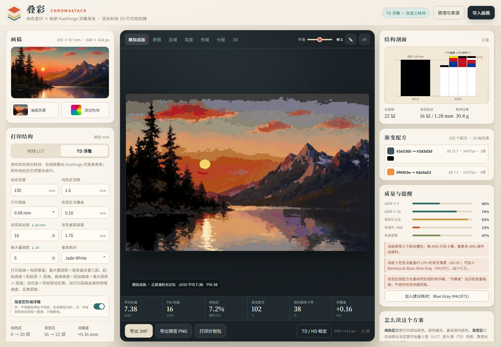
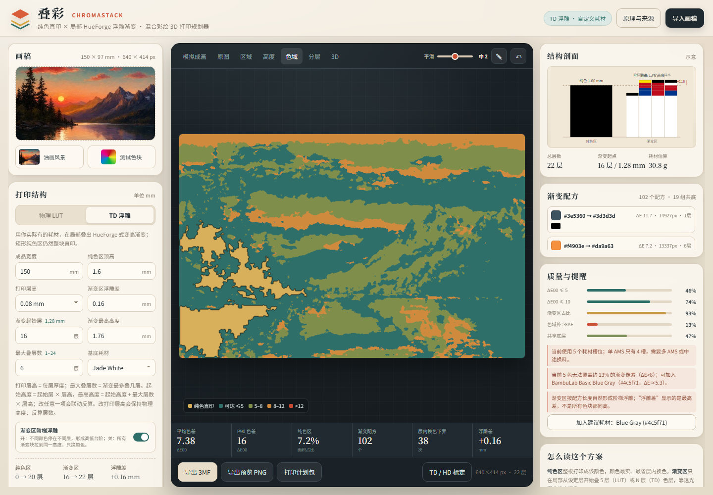
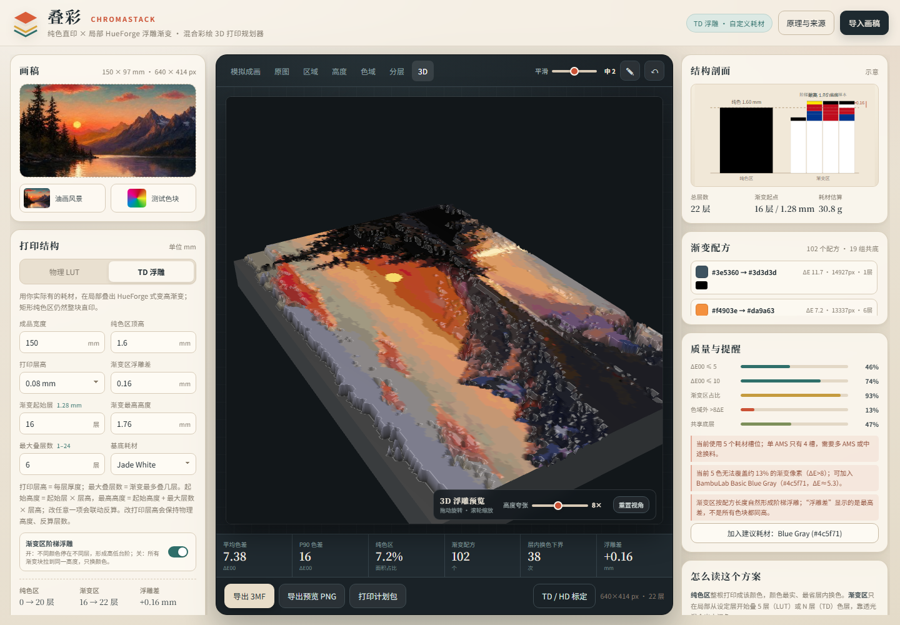
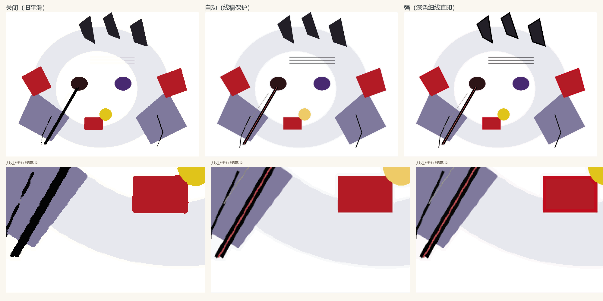
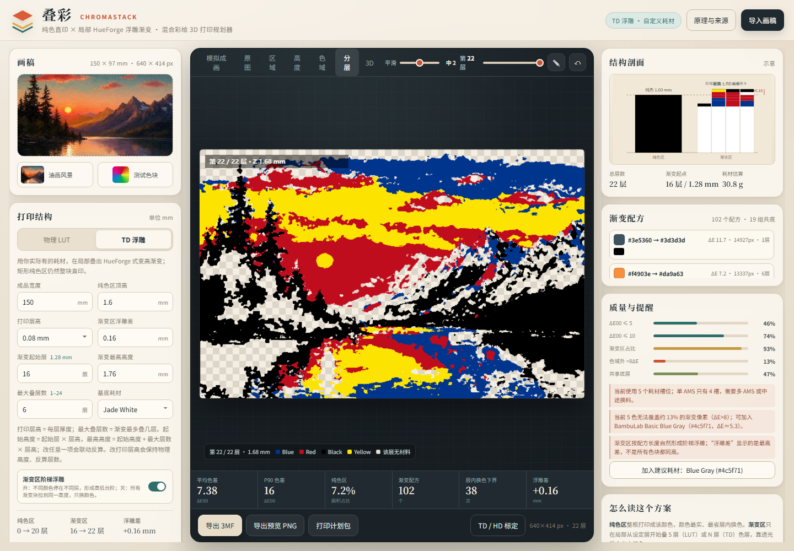

# 叠彩 ChromaStack

**纯色直印 × 局部层叠渐变**的混合彩绘 3D 打印规划器。

它不是 HueForge 的替代品，而是把三条路线缝在一起：

1. **大面积纯色区**：直接整块打印成某一种耗材，颜色最实、层内换色最少。
2. **局部渐变/细节区**：只在需要的地方从指定层开始叠 5 层（物理 LUT）或 N 层（TD 层叠），用透光混色还原中间色。
3. **高度控制**：纯色区顶高、渐变区起始层、浮雕差分开设置，可让渐变区齐平、凸起或凹陷，形成油画的局部厚涂感。
4. **线稿保护**：贴纸/表情包的白底细描边不会被平滑吃掉；强模式可把深色细线改成纯色直印，马赛克/印象派/照片自动保持原流程。

> 只需要浏览器。默认是**纯色直印 + TD 立体浮雕渐变**：用你实际有的耗材，在局部做 HueForge 式的变高层叠。物理 LUT 保留为免标定可选模式。



---

## 快速开始

### 方式一：双击启动（Windows）

双击根目录的 `启动.cmd`。它会用本机 Python 起一个本地静态服务器，并打开浏览器。

### 方式二：手动起服务

```bash
cd app
python -m http.server 8123
# 打开 http://127.0.0.1:8123/
```

> 不要直接双击 `app/index.html`。Chrome 在 `file://` 下可能禁止画布读取本地示例图的像素；用本地服务器最稳。

> 如果启动窗口出现“`'al'`/`'tp:'` 不是内部或外部命令”“系统找不到指定的路径”，那是旧版启动脚本用了 Unix 换行和 `/dev/null` 重定向导致的；当前 `启动.cmd` 已改成 Windows CRLF + `>nul`，关闭旧窗口后重新双击即可。仍不行就手动：`cd app` 然后 `python -m http.server 8123`。

### 第一次用

1. 打开后会自动载入示例油画；也可以拖入自己的图片。工作分辨率可选 **1× / 2× / 4×**（长边 640 / 1280 / 2560 px，默认 1×，画布工具条切换后按原图重新载入并重算）：小图会先高质量放大到合适的工作分辨率（相对缩小封顶，放大倍率上限 1.8×），避免低分辨率线稿直接硬切成锯齿；原图文件不会被修改。4× 只用于预览/分层核对，3MF 导出自适应封顶在 2×（150 mm 幅宽下约 0.117 mm/px，已到 A1 的 XY 定位极限）；切换分辨率会重置手绘修整。
2. 默认 **TD 浮雕**。左边选你实际装着的耗材（默认黑/白/红/黄/蓝 5 色），软件会先找纯色区，再在渐变区枚举/匹配可达的层叠配方。
   - 想看免标定的实测 LUT：把引擎切到 **物理 LUT**（拓竹 8 色或 CMYW 4 色）。
   - 想看哪些颜色当前耗材根本叠不出来：切到 **色域** 视图。
3. 左侧调成品宽度、纯色区顶高、**渐变起始层**、**渐变最高高度**、最大叠层数、浮雕差。起始层/最高高度/最大层数三者联动：改最高高度会反算层数，改层数会反推高度；打印层高在 TD 模式可改（0.04–0.16 mm），LUT 固定 0.08 mm；改打印层高会保持起始/最高物理高度，反算层数。**上传图片会自动做首次计算；之后所有参数和耗材修改都只标记为待计算**，可连续添加多种耗材，再点画布上方「应用并计算」或区域策略底部的计算按钮统一生效。有未应用修改时导出禁用，计算期间再次编辑会继续保留待计算提示。右侧看色差、纯色占比、换色下界和配方。
4. 在画布上切换「区域 / 高度 / 色域 / 分层」检查；色域视图的红色/橙色区域就是当前耗材叠不出的颜色。需要时点画笔手动改纯色/渐变，松开后同样只标记修改，点击计算生效。
5. 点「导出 3MF」，导入 Bambu Studio / OrcaSlicer；核对耗材槽位后切片。

---

## 耗材标定持久化与批量标定

标定数据保存在**服务器的标定 profile** 中（`server/profile-api.js`，self-hosted 上以 systemd 服务运行，nginx 反代 `/chromastack/api/`），每个 profile 一份 JSON（`<DATA_DIR>/profiles/<id>.json`），存 HEX、TD、LUT 分区覆盖及照片标定结果。浏览器 `localStorage` 只保留**当前选择的 profile 指针**和一份离线镜像；手机与电脑选中同一个 profile 即共用一套标定。不会保存成品宽度、背景/包络、3D 状态或其他工程参数，也不会保存原图、分析缓存和内部空腔 ID。标定按耗材 ID 或“品牌 + 型号 + 材料 + 颜色”匹配，新添加同种耗材会自动继承。

- 「耗材 / AMS」卡片顶部的 **标定 Profile** 栏可切换、新建（复制当前标定作为起点）、重命名、删除 profile；旁边显示同步状态（已同步 / 同步中 / 离线）。
- 首次打开自动创建「默认标定」；旧版浏览器-only 存储（`chromastack.filament-calibrations.v1`）会在首次联网时迁移成一个 profile 并删除旧键。
- 修改后约 0.6 s 防抖推送到服务器；关页时用 `keepalive` 立即冲刷。服务器不可达时进入离线模式：修改暂存本机镜像，恢复联网后的下一次保存自动补推。
- 顶部「重置标定」只清空**当前 profile** 的标定内容（保留 profile 本身），其他工程参数不变。
- 本地 `启动.cmd` 开发页面默认直连部署服务器的 API（可用 `localStorage` 键 `chromastack.api-base` 覆盖）；损坏或旧版本配置安全回退，存储不可用只提示不阻断编辑。
- 「批量标定 → 生成全部标定板 3MF」会生成 100×100 mm 的黑色两层薄底金字塔：白色料带先直接叠在黑底上，随后每种耗材各占一段连续 Z 区间，每色三道嵌套方阶提供三个累计厚度。每个 Z 层仅一种耗材，换色只发生在料带边界；四角白色定位柱贯穿白色料带，但不会在后续颜色层引入白色。
- 打印后从正上方拍摄完整标定板，点「上传照片批量识别」。应用按四点透视校正，用白色三阶的相对亮度联合求白平衡与白色 HD，再利用每色三阶同时拟合实际实色和 `T = 10^(−d/HD)` 中的 HD；不会把仍可能透光的最后一阶误当成完全不透光。下一料带使用上一料带末阶的实测颜色作为真实基底。预览会显示定位点和采样框，确认对齐后再点「应用全部标定并保存」。
- 板高由耗材原 HD 和打印层高决定，每色 3–10 层；界面生成后显示实际总高和段边界换色次数，切片器的擦料塔与额外冲刷另计。照片拟合属于近似测量，仍受曝光、反光、镜头、打印温度和批次影响；请检查识别置信度，必要时用单色楔形复核。
- 「上传多色矩阵照片识别」对应 75 mm、12 层的黑白双基底矩阵板（`tests/generate-multicolor-td-75mm.py` 生成，A1 mini 实测打印规格：首层 0.24 mm、其余 0.08 mm）。左半黑底、右半白底，各 18 格：黑/白/红/蓝每色 1/4/10 层单色厚度锚点 + 6 个跨色叠层配方；四角为黑白混合定位点（黑底上两白、白底上两黑）。前向混色在辐射度空间线性，相机增益在“实测基底 + 锚点”联合拟合中自动消去：每色六锚点同时解实色与 HD，白色锚点因实色恒为纯白而兼作白平衡基准，12 个跨色格用解出的参数逐层预测再做 ΔE00 交叉验证。定位点用均匀区域分割 + 环对比检测（两层黑定位点压白底实际是中灰，全局亮度阈值不可靠），黑白极性序列自动解析照片的 90° 旋转。拍摄要求：正上方、整板与四角定位点入镜并尽量充满画面、均匀漫射光、不反光不对焦模糊、关闭 HDR/美颜。识别后同样在弹窗核对绿圈定位点与采样框，再「应用全部标定并保存」写入当前 profile。HD 由同厚度黑/白两半的**线性亮度差**直接解出透射率 `T(d) = (Y白−Y黑)/(Y底白−Y底黑)` 再对厚度回归——实色、反光 veil、相机增益全部消去；低于噪声底的厚度对只贡献斜率下界，保证近不透明耗材的 HD 不被单点色度噪声带跑；实色由 4/10 层锚点闭式解出，削顶/削底通道按删失处理（全削底通道记 0，如蓝料的红通道）。混色交叉验证平均 ΔE > 6 红字警告；> 10 且照片辐射度特征异常（白平衡增益 > 1.15、黑底被提亮、白锚点拟合差）时禁止应用——典型为手机 HDR/AI 场景优化，这类照片破坏辐射度线性，需关闭 HDR/AI 优化重拍；若单色锚点自洽而混色格偏大（换色冲刷不足污染，如 R>K 发灰），警告但允许应用。定位点检测对打印层纹与 JPEG 噪声鲁棒（平滑亮度 + 不相交窗均值梯度 + 环对比 + 尺寸门限 + 0.45 角半径，手持留边也能找到）；方向判定枚举 8 种二面体配对、按黑白极性过滤后用“差分透射率落在 (0,1) 且随厚度递减”打分，与耗材库当前取值无关，镜像照片（切片翻转或前置摄像头）也能正确解算。

---

## 两种渐变引擎

| | TD 浮雕（默认） | 物理 LUT（可选） |
| --- | --- | --- |
| 颜色来源 | Beer–Lambert 遮盖模型 + 当前耗材的可达色域枚举，逐色匹配层序 | Lumina Studio 的拓竹 PLA Basic 实测 5 层 LUT（1024 组配方） |
| 需要标定 | TD/HD 参考值；可用内置校准器修正 | 不需要（直接选预置） |
| 耗材 | 任意耗材，最多 8 槽 | 固定为 LUT 配色：8 色宽色域，或 CMYW 4 色 |
| 渐变高度 | 可调最大 1–24 层；**配方短的色块自然形成低台阶** | 固定 5 层 × 0.08 mm，等高 |
| 适合 | 已有自己的耗材、想做局部 HueForge 浮雕 | 想快速出片、没有标定数据 |
| 当前示例（平滑 2 + 合并 4ΔE） | 5 色平均 ΔE00 ≈ 7.4，P90 ≈ 16；47% 渐变像素共享底层；加 Blue Gray 后 ≈ 5.9 | 8 色平均 ΔE00 ≈ 5.1，P90 ≈ 9（平滑关 ≈ 4.2 / 7） |

**TD 的默认 5 色**：黑、白、红、黄、蓝。单 AMS 只有 4 槽时删掉一个；色域视图会告诉你缺什么色。

**阶梯浮雕是什么意思**：开“渐变区阶梯浮雕”时，不同颜色用 1–最大层数的配方，停在不同高度，顶面有高低台阶；关掉后所有渐变色块都堆到最大层数，顶面齐平，只保留颜色层叠。

**LUT 的 8 色**：黑、白、红、黄、蓝、绿、青、品红。单 AMS 只有 4 槽时，选 **CMYW 4 色**，但大面积黑/红/蓝会退化为渐变，纯色覆盖会明显下降。

**TD** 是 HueForge 常用的透光距离；正面观看的遮盖距离近似 **HD ≈ TD × 0.1 mm**。软件里用 `T = 10^(−d / HD)` 在**线性 RGB** 中逐层合成，再和原图做 CIEDE2000 色差。

---

## 拓竹 PLA Basic 常见 TD（快速选择）

数据来自 HueForge 官方 affiliate 耗材库（经 `prusa3d/prusa-fdm-mixer` 同步，2026-11 抓取），另补入拓竹 CMYK 套装的 Cyan/Magenta，共 16 个 PLA Basic 颜色。**TD 是社区/厂商参考值**，批次、温度、层高、线宽和喷嘴都会让它漂移。

| 颜色 | Hex | TD | HD ≈ TD × 0.1 |
| --- | --- | ---: | ---: |
| Black | `#000000` | 0.6 | 0.06 mm |
| Jade White | `#ffffff` | 5 | 0.50 mm |
| Beige | `#e7ceb5` | 8 | 0.80 mm |
| Blue | `#00358e` | 4 | 0.40 mm |
| Blue Gray | `#4c5f71` | 3 | 0.30 mm |
| Brown | `#9d432c` | 2 | 0.20 mm |
| Cyan | `#0086D6` | 3.5* | 0.35 mm |
| Magenta | `#EC008C` | 3.0* | 0.30 mm |
| Gray | `#8e9089` | 2 | 0.20 mm |
| Green | `#003b3b` | 2 | 0.20 mm |
| BambuLab Green | `#00ae42` | 4 | 0.40 mm |
| Orange | `#ff6a13` | 7 | 0.70 mm |
| Pink | `#ff5869` | 8 | 0.80 mm |
| Red | `#c00d1e` | 5 | 0.50 mm |
| Silver | `#a6a9aa` | 0.5 | 0.05 mm |
| Yellow | `#fce300` | 6 | 0.60 mm |

Cyan/Magenta 的 hex 来自拓竹 CMYK 说明；TD 3.5/3.0 是 CMYW 参考起点（社区有 Cyan 3–5、Magenta 3 左右的差异），**不是** affiliate 库条目，量产前请用标定器修正。

完整 CSV 在 [`data/bambu-pla-basic-td.csv`](data/bambu-pla-basic-td.csv)。应用内置 627 条耗材库（拓竹 Basic / Matte / Tough 等），点「从耗材库添加」可直接搜索加入；AMS 卡下方也有 **+ Cyan / + Magenta** 快速按钮。若搜索显示 0 条，先 `Ctrl+F5`：静态资源已加版本号，避免旧缓存继续使用 625 条的耗材库。

> LUT 配色里的 Cyan/Magenta/Yellow 采用拓竹 CMYK 套装的色值（`#0086D6 / #EC008C / #F4EE2A`）；HueForge 库里的 Yellow 是另一条产品线（`#FCE300`），两者不要混用同一套标定。应用已按 LUT 的实际情况处理。

---

## 有限耗材下怎么判断“这块渐变能不能做”

这是软件里最关键的策略：

1. **先分纯色区**：局部方差低、且颜色能被某个现有耗材直接覆盖（ΔE 小于阈值）的区域，整块直印。
2. **再为渐变区建可达色域**：用当前耗材、层高、基底和最大层数，枚举所有可能的层序（4 色 × 6 层约 5,460 条；5 色约 19,530 条；更大的调色板会采样/截断）。每条层序按 Beer–Lambert 算出一个真实能打印的颜色。
3. **按颜色匹配，而不是按“看起来像”**：每个渐变色块找色域里最近的颜色，记录 ΔE。色域是物理上可达的，所以匹配结果不会假装“加一层青就能变蓝”。
   - 层序被限制为**连续色段**：一种耗材最多出现一段，不会出现红-蓝-红-蓝这种反复交替；它更接近“先一片红、再一片蓝”的真实浮雕层序。
4. **色域外可视化**：切到「色域」视图，纯色直印是金色，渐变按可达性分绿/橄榄/橙/红。红色区域就是当前耗材叠不出来的颜色，右侧会给出**具体缺少的 Bambu Basic 耗材**，可连续加入后再点击计算统一应用。
5. **浮雕高度是配方的结果**：同一颜色可能用更短或更长的层序；软件优先颜色，再在 0.5 ΔE 内选更短配方。短配方形成低台阶，长配方形成高台阶，于是渐变区得到 HueForge 式起伏。耗材越少、颜色越受限，台阶可能越碎；可以关闭“渐变随配方变高”，或加耗材来改善。

示例：默认 5 色 + 平滑 2 + 合并 4ΔE 在示例油画上约 13% 渐变像素 ΔE>8（主要是青绿天空/水面）；47% 的渐变像素共享底层。点「加入建议耗材」加 Blue Gray 后，平均 ΔE00 从约 7.4 降到 5.9。合并/平滑关掉时色差更低（约 6.3），但分层图里会有更多细碎色点和更独立的底层。


*色域视图：金色=纯色直印，绿/橄榄=可达，橙/红=当前耗材难以覆盖。*

---

## 3D 浮雕预览

切到画布上方的「3D」标签，可以拖动旋转、滚轮缩放。默认是**材料堆叠**视图，重置视角为保持原图上下/左右方向的正面侧角。



- **材料堆叠**：平顶单元显示规划器的光学混色结果；所有外露台阶、外圈侧壁按真实耗材逐层着色。开启 **X 剖面**并拖动位置，可裁去右侧部分，直接查看该列从底层到顶面的完整材料序列，不显示走线。
- **成品混色**：保留原来的最终预测色高度场和平滑法线，用于只看成品厚涂外观。
- **高度夸张**：1–16×，只影响预览，不影响 3MF 或实际打印高度；默认 8× 是为了让 0.08 mm 的层差肉眼可见。
- 3D 使用当前已计算方案的实际顶高、逐层 recipe 和预测颜色；参数编辑会先标记为待计算，点击计算后才重建。
- 堆叠视图不模拟喷嘴走线，也不是路径追踪渲染：顶面混色来自与打印规划相同的 Beer–Lambert / LUT 预测，侧面和剖面显示未混合的真实耗材色。
- 3D 预览不导出；需要打印模型仍用「导出 3MF」。

---

## 背景移除与异形轮廓

左侧「背景 / 轮廓」默认关闭，保留完整矩形。启用后仍遵循手动计算流程：选自动或取色、调容差，再点击计算统一生效。

- **自动识别边框主色**：统计四边的主色，适合白色或近纯色背景；深色背景自动把容差提升到至少 12 ΔE，吸收 JPEG/WebP 压缩和抗锯齿碎点，手动取色仍按输入容差。
- **点击画面取背景色**：切到原图后点击背景像素；进入取色状态时旧导出立即失效，选择颜色后还需点击计算。
- **只删除边界连通区域**：颜色容差使用 ΔE00。与边缘相连的近背景色才移除，封闭的白色脸部、眼睛高光和内部浅色不会因为同色而被误删；脱离背景的小前景也会保留。
- **气泡式包络（默认开启）**：用欧氏距离场求出让全部前景刚好连通的半径，再增加贴合余量并平滑轮廓，形成圆弧凸起而不是直线桥。即使一个像素的原始符号也不会为了连通而被删除；连通按真实四连通网格计算，不把对角接角当成一个实体。余量可调，也可关闭以保留原始的离散轮廓。
- **内部区域删除 / 恢复**：包络封口前的封闭空腔会获得独立 ID 和命中图。点击「删除 / 恢复内部封闭区域」后在画面上点选，可单独留空或填回，不破坏外轮廓连通。改变宽度、背景模式、容差或包络余量会使旧 ID 失效，需先计算再编辑。
- **包络只作低层支撑**：新增闭合/桥接区域只打印到渐变起始层，不继承原背景的直印顶高，不形成白色高墙，也不改变原始图案颜色。支撑计入材料重量，但不计入渐变色族、色差或浮雕顶高统计。
- **统一 `printMask`**：模拟成画、区域/高度/色域、逐层图、材料堆叠、X 剖面和原生 3MF 共用同一轮廓，背景在所有层都没有材料。空白处以棋盘格显示。
- **安全回退**：如果识别会删空整幅图，自动放弃本次移除，实际移除数记为 0，不生成空模型。
- **原生异形导出**：默认按真实分辨率复制轮廓，包括小图和非方图；显式紧凑降采样会近似轮廓与细节，不应与原生预览逐像素对比。

---

## 结构平滑（按毫米，不按像素）

画布上方工具条里的“平滑”是**最小可打印结构尺寸（mm）的精确数字输入**，默认 **0.8 mm**，不再用容易跳变的滑块；修改后点击计算生效，旁边显示实际采用的像素半径。另有「喷嘴线宽」输入（默认 0.42 mm），用来提示什么尺寸是喷嘴能稳定打出的最小细节。

规划时按当前成品宽度把毫米换算成像素半径：

`半径 px = round(平滑尺寸 mm / (2 × 像素尺寸 mm))`

像素尺寸 = 成品宽度 / 工作图宽度。例如：

- 150 mm 宽、640 px 工作图：0.23 mm/px，0.8 mm → 半径 2 px（5×5 多数表决）；和旧“平滑 2”接近。
- 80 mm 宽、600 px：0.13 mm/px，0.8 mm → 半径 3 px；物理上仍是 0.8 mm，不会因为图变小就过度平滑。
- 300 mm 宽、640 px：0.47 mm/px，0.8 mm → 半径 1 px（受分辨率限制，实际约 0.94 mm）。

它同时作用于纯色/渐变二值区和渐变色族；3MF part 数和三角面随之下减。半径按毫米完整换算，不再被旧实现的 8 px 上限静默截断（例如 75 mm / 600 px 的 3 mm 应为半径 12 px）。边缘吸附和矢量化后会再做一次同半径收尾，避免后续逐像素归并重新制造碎配方；最后按 **2×喷嘴线宽对应的最小圆面积**清理残余孤立区域，而不是把 3 mm 直接变成大面积删图。代价是颜色误差会上升。若平滑尺寸小于喷嘴线宽，右侧会提醒：小于喷嘴的细节本来也可能打不出来。0 = 关闭；目前范围 0–3 mm。

旧版 `smoothLevel` 仍保留在引擎 API 里用于兼容旧计划，但网页不再暴露。

---

## 层序合并：让相邻渐变色共享底层

这是“更像 HueForge、更好打印”的关键一步。

之前的实现会把渐变颜色聚成若干色族，每个色族**独立**选一条完整层序。结果是：相邻的紫色和红色可能有完全不同的底层，它们在 3D 里是两个独立的小结构，层内换色和细碎边界都很多。

现在的 TD 增加了一个 **层序合并 ΔE** 滑块（0–10，默认 4）：

- 目标色差在阈值内的渐变色族会连成一组。
- 每组从代表色族的 recipe 里取一段**公共底层**；组内所有色族都必须以这段完全相同的前缀开始。
- 底层之上再各自选择顶部层序，保留局部颜色差异。
- 允许合并造成的额外色差不超过同一个阈值；在满足条件的前提下优先取**最长的公共底层**。
- 例如紫→红：底层统一成紫（红+蓝），更红的位置在顶部叠更厚的红，而不是各自从完全不同的底层重新开始。
- 0 = 关闭，颜色最准但结构最碎；阈值越高，共享底层越多、层内结构越整体，但颜色可能更偏。

示例默认合并 4ΔE：19 组共享底层，约 **47% 的渐变像素**至少共享一段底层；平均 ΔE00≈7.4。关闭合并（保持平滑 2）回到约 7.2；同时关掉平滑约 6.3，但 3D 层图和切片里会看到更多孤立小结构。

---

## 高度去重：颜色没变，就别叠那么高

有限耗材下常见一种“无效浮雕”：原图里相邻两处只差一点亮度（眼睛边缘 vs 脸颊），软件为了追这点亮度，给其中一处选了更长的配方，最后预测颜色却几乎一样。结果就是外观相同、高度差很多，3D 预览里出现没有颜色收益的凸起。

「区域策略 → 高度去重 ΔE」在层序合并和最高高度抬升之后运行：

- 比较的是**预测颜色**，不是原图目标色；预测色差 ≤ 阈值（默认 1.5 ΔE）才考虑。
- 高配方至少比短配方多 **4 层**才处理；只差 1–3 层的细台阶保留。
- 短配方代表的面积必须 ≥ 高配方的 **75%**，避免把大面积白色/黑色主区域压成小岛的高度。
- 短配方对高配方自身目标色的误差不能比原配方差超过一个阈值，防止“为了矮而明显偏色”。
- 满足条件时直接采用短配方的层序，并把**配方完全相同**的色族真正合并成一个 family；之后预测色、顶高、3MF part 都按新配方生成。
- 0 = 关闭；阈值可调到 5，用来合并“看起来差不多但数值上差一点”的颜色。只对开启“渐变区阶梯浮雕”的 TD 方案生效。

这会把“最高高度”从硬性目标变成**上限**：如果最高的那一段只是为了不可见的色差，实际最高点会降下来，UI 会提示合并了多少色族、最高从多少层降到多少层。大面积主色仍会保留自己的高度。

---

## 线稿保护：细线和直边不被平滑吃掉

贴纸、表情包、白底线稿有一个和油画相反的需求：**1–3 像素的黑色描边必须连续**。原来的颜色无关多数表决会把细线判给周围的白发/白纸，于是直线变成断续的点。全局矢量化不是好办法：3MF 的 marching squares 已经在做轮廓拟合，而把整幅画强制成矢量色块会破坏马赛克、像素画和印象派的颗粒感。所以这里做的是**定向的线稿保护**，不是全局矢量化：

「区域策略」里的 **线稿保护** 有三档：

- **自动**：只在“白纸占比高 + 深色细线/描边多”的图上启用。检测到线稿后，普通区域使用**颜色双边表决**；受保护线条只与其他线条像素投票，在保持覆盖的同时统一连续配方，白色邻居不能把黑线投掉。候选配方还有“明度不能超过原线条”的硬约束。孤立深点不享有整段线稿的豁免，仍会进入最后的喷嘴级孤岛清理。照片、油画、没有白底的马赛克不会触发。
- **强（全色线稿直印）**：在自动的基础上，把深色及高彩度细线直接改判为**纯色直印**，用最接近的合适耗材而不是层叠配方。找不到接近颜色时保留渐变，避免换错色；大面积彩色填充中心不会被误判为细线；灰色抗锯齿外圈会继承附近已确认线芯的颜色，避免描边外圈断成黑点。匹配有明度、彩度、色相门限，避免深紫头发被蓝耗材描成蓝色毛边；并向外扩 1 像素，让 0.4 mm 喷嘴能真正铺出这条线。细线与纯色区同高，因此相邻渐变区会略高于它，形成凹刻线。
- **关闭**：保留旧的颜色无关平滑，适合想复现旧结果或做特殊实验。

代价：强模式会在所有层里多出黑/红等描边耗材，层内换色下界明显上升；1 像素都不到的线仍可能无法打印。**网页默认使用强模式**，让中文细字、Logo 和描边贴纸保持连续，避免渐变配方把文字打碎；照片和印象派可切回自动（通常不会触发）。黑色描边属于原图前景，不能用背景容差删除。

在贴纸线稿测试图上，自动模式把平均 ΔE00 从约 3.2 降到 1.9（7 色）；强模式进一步把细线变成连续实色，但换色更多。细线像素的“被抬亮超过 30 L”的比例为 0。



上图用合成贴纸测试：关闭旧平滑时，顶部平行细线和刀刃会出现断点；自动模式保留连续线；强模式把黑色描边直接印成实色。强模式不改变大面积渐变，只处理深色细线。

---

## 边缘光晕清理：去掉抗锯齿过渡色

原图的线条边缘有 1–2 像素的抗锯齿过渡色（黑与白/头发色之间的灰调）。这些过渡色如果进入 k-means，会自成一族；在有限调色板下经常被配成黄/蓝/红的短配方，于是每一层预览里都能看到黑线周围一圈彩色细噪点。

「区域策略 → 边缘光晕清理」分 0–3 档（默认 1）：

- 用 Lab 相邻梯度找出抗锯齿边缘，并向内扩 1–3 像素。
- 这些边缘像素**不参与颜色族聚类采样**，避免它们污染中心色；然后逐圈寻找最近的“核心像素”（或受保护的描边像素），把边缘像素归到该核心的 family/recipe。若候选色比当前边缘 family 的预测色差太多（超过约 2 ΔE 的保护余量），则保持原样，避免强档把画面洗脏。
- 只在渐变区占总像素 ≥20% 时启用；接近纯平线的图会跳过，避免把细线当边缘吃掉，右侧会提示“已跳过”。
- 0 = 关闭；1 默认、最温和，只清理完全位于边缘带的小岛；2 中等；3 除扩大边缘带外，还会清理全图的喷嘴级孤立小区域，会明显改变颜色，建议先试 1–2。所有档位的末尾都会按最终“纯色耗材 / 渐变色族”连通域检查，线稿保护不再把孤立碎点排除在外。
- 分层视图里，原本细碎的彩色点会变成与相邻区域一致的整块底层；空白棋盘格表示该处配方已经结束，不是最终表面。最高层只包含最高的少数色块，黑色小点可能是最高的眼睛/发丝细节，不一定是噪点；最终颜色看「模拟成画」或「3D」。

## 矢量化色块直印（贴纸/扁平插画）

对于贴纸、表情包这种“大面积平涂 + 黑描边”的图，继续用分层渐变会在首层产生红/蓝细噪点。现在「区域策略」提供一个 **矢量化色块直印** 开关：

- 统计每个色族的**平均颜色、颜色方差、物理面积**；
- 如果面积够大、颜色足够均匀，且**最终预测色**（不是原图均值）与某个耗材的 ΔE 在可接受范围内，就把整个色族改成**整块纯色直印**，不再使用层叠 recipe；
- 把抗锯齿带里没有核心的零碎小岛并入相邻区域，并以“最近的**大区域**或 flat 色”做一次边界归并（watershed），边缘小色族不再拥有自己的 recipe；
- 条件不满足的色族（真正的渐变、小面积高光、纹理）继续分层；
- 先清理**完全位于抗锯齿边缘带内**的小岛，再按最终纯色/渐变连通域做喷嘴级收尾；跨纯色边界或带线稿保护标记的孤立碎点也会被归并。归并优先选择与原区域颜色最接近的邻域，避免把彩色细节吸成黑块；
- 直印区域统一到纯色区顶高，因此会低于局部浮雕渐变；这正是贴纸想要的平涂效果；
- 适合贴纸/线稿/扁平插画；照片、油画、印象派不要开。

在同类贴纸测试里，开启后纯色区从 60.7% 升到 72.8%，平均 ΔE 从 1.98 降到 1.86；第 6 层的白发/脸/大面积红蓝块变成整块直印，边缘红黄噪点明显减少。它不是 SVG 轮廓追踪，而是**按颜色族做区域级矢量化并直印**；3MF 仍是水密 part。

| 控制 | 建议 |
| --- | --- |
| 平滑（mm） | 先调，按成品尺寸决定合并多大的孤立色块；建议 ≥2×线宽 |
| 合并 ΔE | 再调，让相邻渐变色共享底层 |
| 高度去重 | 颜色看起来一样但高度差很多时开大；0=保留所有高度 |
| 边缘光晕清理 | 黑线周围有黄/红/蓝细噪点时用 1–2；0=关闭 |
| 矢量化直印 | 贴纸/扁平插画开；照片/渐变画关 |
| 线稿保护 | 贴纸/表情包用自动；要硬轮廓用强；照片保持自动 |
| 最大叠层数/最高高度 | 控制整体浮雕高度 |
| 高度夸张 3D | 只影响观察，不影响打印 |

---

## 分层预览里的透明棋盘格

切到「分层」视图后，**浅色棋盘格表示该层没有材料**，不是黑色耗材。黑色耗材会显示成实心黑色，所以不会再把“黑色”和“从这一层开始空了”混在一起。



图例里也会显示“该层无材料”。导出的 `layer_maps/*.png` 仍是透明 PNG，透明像素就是未打印区域；用图片查看器打开时通常会显示棋盘格。

---

## 标定（可选）

侧栏「TD / HD 标定」里可以：

- **下载标定楔形 3MF**：2 mm 黑色或白色基底，旁边是 1..N 层递增的目标耗材阶梯，以及一条 N 层全厚度参考条。两个材料各占一个槽位。
- 打印后找出**第一片和参考条看不出区别**的片号 k。
- 输入 k、层高、底色，按 2 ΔE00 视觉阈值反解 `T*`，再算 `HD = −d* / log10(T*)`，`TD = 10 × HD`。
- 计算器会把 TD 写回当前耗材。LUT 模式的颜色来自实测色卡，标定主要影响 TD 模式和基底遮盖判断。

这个流程是标量近似（三通道用同一个 HD）。要更准，可以：

- 用 HueForge 的 **Seashell** 方法；
- 用 Ajax-3D **TD-1** 传感器；
- 或用 Lumina Studio / Kromacut 的完整标定流程做逐通道/矩阵校准。

---

## 打印与切片

- 需要 **AMS / MMU / 换刀机**；模型是多种耗材在同一层并排，单色手动换料无法完成。
- 3MF 是**一个多 part 对象**：每个“颜色 × 连续层区间”是一个水密 part，`Metadata/model_settings.config` 已写入 extruder 编号；导入后先核对槽位。模型坐标已直接放到 256 mm 板的 128,128 中心，不再依赖切片器的装配变换。
- Bambu Studio 对非 Bambu 项目 3MF 可能提示 **“3mf 文件配置无效，仅加载几何数据”**。这是“不加载第三方打印参数，只读几何/颜色”的提示，不是文件损坏：点 **确认** 即可。导出已把颜色写到**每个三角面的 `pid/pindex`**，Bambu 的标准 3MF 颜色解析会据此创建耗材；若弹出“标准 3MF 导入颜色”窗口，点 **追加** 把模型颜色加入耗材列表，自动合并了相近颜色时可在窗口里调整颜色数量/手动匹配。若同时弹“对象尺寸过小/是否转换为毫米”，选 **否**；若弹“是否将多部分对象组合成一个对象”，选 **是**。
  > 旧版导出只有对象级材质，Bambu 会把它当纯几何，沿用当前项目的 2 个默认耗材——这就是“为什么只有两个耗材”的原因；重新导出后即可按面颜色识别。
- LUT 校准条件是 **0.08 mm 层高、0.42 mm 线宽、白色基底**。LUT 模式下切片层高不要改。
- 100% 填充，关闭“平滑/模糊皮肤”；否则会破坏颜色边界。
- 模型是许多封闭 part 的集合，切片器会做布尔合并；如提示悬空/重叠，先看切片预览，不要直接忽略。
- 本工具右侧有**悬空检查**：逐层比较占用面积，只有第 1 层允许“从无到有”，之后每层都必须是上一层的子集。正常方案会显示“无新增面积”。Bambu 若仍提示“浮空区域”，多半是它按 part 单独检查、把颜色层 part 当成没有支撑；以本工具的层占用检查 + 切片预览为准。
- 打印前先打小样。颜色预测是正面漫射光近似，实物还受批次、温度、观察光影响。

---

## 目录

```
HybridColorPrint/
├─ app/                     # 可直接运行的网页应用
│  ├─ index.html
│  ├─ css/app.css
│  ├─ js/
│  │  ├─ color.js           # sRGB / CIELAB / ΔE2000
│  │  ├─ data-filaments.js  # 625 条耗材 TD 库
│  │  ├─ data-lut.js        # 拓竹 PLA Basic 4/8 色实测 LUT
│  │  ├─ engine.js          # 分割、聚类、LUT/TD 配色、高度规划
│  │  ├─ zip.js             # 无依赖 ZIP
│  │  ├─ earcut.js          # 多边形三角化
│  │  ├─ exporter.js        # 3MF / 打印计划
│  │  ├─ calibration.js     # 标定楔形 3MF
│  │  ├─ batch-calibration.js # 金字塔批量标定板与照片反解
│  │  ├─ matrix-calibration.js # 75mm 多色矩阵板照片 TD 反解与交叉验证
│  │  ├─ profiles.js        # 服务器标定 profile 客户端（指针/离线镜像/迁移）
│  │  ├─ settings.js        # 标定快照与持久化委托
│  │  └─ app.js             # UI 控制器
│  └─ samples/              # 示例画
├─ server/                  # profile-api.js：零依赖 Node 标定存储服务
├─ deploy/                  # nginx 参考配置、chromastack-api.service
├─ data/                    # TD CSV、LUT 数据、来源
├─ docs/                    # 技术说明、许可、截图
├─ research/                # 已下载/摘录的相关开源项目
├─ tests/                   # Node / Python / Playwright 验证
├─ 启动.cmd
└─ README.md
```

---

## 开源来源与许可

本项目以 **AGPL-3.0-only** 发布，因为使用了 Lumina Studio 的实测 LUT 数据并参考了 Kromacut 的正面遮盖与分区导出思路。详见 [docs/NOTICE.md](docs/NOTICE.md)。

- **Lumina Studio / Lumina-Layers**（AGPL-3.0）：拓竹 PLA Basic CMYW / 8 色实测 LUT、5 层叠色思路。[官网](https://www.luminastudio.com.cn/) · [GitHub](https://github.com/lumina-layer-studio/Lumina-Layers)
- **Kromacut**（AGPL-3.0）：正面 Hiding Distance、Flat Paint、分区 part 3MF 导出思路。[GitHub](https://github.com/vycdev/Kromacut)
- **Prusa FDM Color Mixer**（MIT）：交替层混色校准与色差评估方法，以及 HueForge 耗材库同步数据。[GitHub](https://github.com/prusa3d/prusa-fdm-mixer)
- **HueForge 社区耗材库**：TD 参考值（经 prusa-fdm-mixer 同步）。HueForge 是 The HueForge 的商标；本项目与官方无隶属关系。
- **earcut**（ISC）：多边形三角化。

---

## 已知限制 / 下一步

- 3MF 是**一个包含多个水密 part 的对象**，每个 part 对应一段颜色/层区间；切片器负责做多材料合并。已在 trimesh 中逐 part 验证水密。
- 纯色区是整根实心打印，耗材用量会比“薄壳+顶色”多；这是为了颜色最实、最不依赖遮盖。
- 3MF **默认按网页当前方案的原生分辨率导出**，同分辨率直接逐像素复制，不再默认降到 300 px；导出网格长边自适应封顶 1280 px（工作分辨率 4× 只影响预览/分层，避免页面卡死与文件无谓翻倍）。这样网页分层/3D 与模型使用完全相同的 family、短配方和顶面高度，不会在黑色配方结束后被重采样成持续到更高层的白色实体。模型 XML 按对象分段编码成字节再写入 ZIP，大体量导出不会触发 JS 字符串长度上限；若显式传 `{ exportMax: 300 }` 做紧凑导出，采样按输出像素覆盖的源区域多数表决并做喷嘴级孤岛收尾，但细线和短配方仍可能因降采样改变，不应把该预览与原生网页逐像素对比。模型 XML 用 DEFLATE 压缩；复杂线稿原生导出可能达到数十 MB，压缩不可用时会回退到未压缩 ZIP。
- LUT 只有 1024 组配方，细节不如 HueForge 的 0.04 mm 多层堆叠；要更细可上 TD 模式、加层数、换更多耗材。
- 目前没有直接生成 G-code；只导出规划、图层和 3MF。切片参数、擦料塔和实际换色由切片器决定。
- TD 引擎在 4 色时色域有限；色差表会诚实地显示。想要好结果，优先用 LUT，或在 TD 里加蓝/青/品红等色相跨度大的耗材。
- 渐变区共享同一个起始层/最大叠层数；单个色块的顶高由配方长度决定，但不能单独给某个选区设独立高度（下一步）。
- 在有限耗材下，浮雕台阶可能较碎；这是配方长度受限的物理结果，不是显示 bug。关闭“渐变随配方变高”可得到等高的层叠色块。
